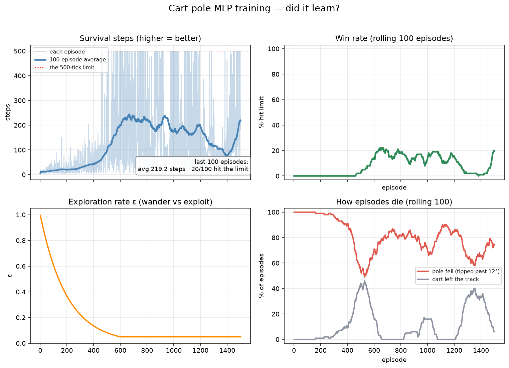
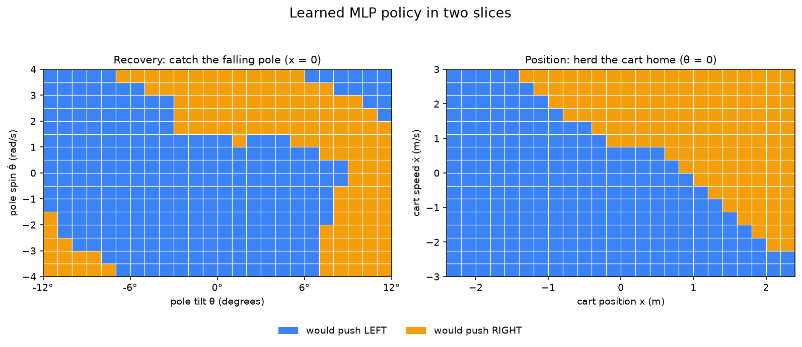

# Project 3 — Cart-Pole Inverted Pendulum with an MLP (DQN)

Status: done — environment → agent → train → play → charts → tests,
55 checks green.

## The goal

The SAME game as project 2 — balance a pole on a cart by pushing
left or right, +1 per step alive, win by surviving 500 steps — but
a DIFFERENT brain: no Q-table, no buckets. A deep neural network
(an MLP) predicts the Q-values, trained with DQN. Same game,
different brain, so the two report cards compare directly.

- **The state is still four continuous floats**: `x, ẋ, θ, θ̇`. In
  02 they went through a binner into 7,680 table rows. Here they go
  straight into `MLP(4 → 64 → 64 → 2)` — one Q-value per action out.
- **The physics are byte-for-byte identical** to 02 (same masses,
  ±2.4 m track, ±12° limit, semi-implicit Euler). The hand-computed
  first step still pins it: `x=+0.004416, θ=-0.017143`.
- **The teacher is DQN**: replay buffer (50k), frozen target net
  (sync every 500 steps), ε-greedy 1.0 → 0.05, Adam 1e-3, γ=0.99 —
  all in PyTorch, on CPU, in seconds-to-minutes.

## What I built (the plan, done)

1. ✅ **The world from scratch** — `environment.py`: Newton's
   equations, `reset() / step(action)`, done at ±12° / ±2.4 m /
   500 steps. Identical to 02 on purpose.
2. ✅ **The brain** — `agent.py`: `QNetwork` MLP + `ReplayBuffer` +
   `DQNAgent` (online/target nets, TD loss, ε-greedy). The binner
   is gone; `normalize_state()` (≈ ±1 inputs) replaces it.
3. ✅ **The school** — `train.py`: the same ε-greedy loop, metric =
   avg steps survived — plus a softer fall bill (−10, not −30) and
   1,500 episodes instead of 15,000 (generalization is sample
   efficient). Greedy exams + best-weights diploma, as in 02.
4. ✅ **The window** — `play.py`: HUMAN / WATCH / LIVE / TRAINED,
   same pixels as 02, DQN behind the glass (`dqn_model.pt`,
   300-episode safety net, slower LIVE ladder).
5. ✅ **Tests + charts** — every claim below is pinned: 12 physics
   checks, 13 brain checks, 9 school checks, 12 window checks
   (headless), 9 chart checks. Curves + policy slices via
   `visualize.py`.

## Important concepts (the new ones this project taught me)

### 1. The binner was a crutch — the MLP eats floats

02 chopped each float into buckets (`round()`, clipping, the
few-vs-many tradeoff, 7,680 rows). None of that survives here:
matrix multiplies don't care whether `x` is 0.0044 or 0.00441.
The only preprocessing left is **normalization** — divide by
`(2.4, 3.0, 12°, 4.0)` so no input dominates the gradients. One
gradient step moves ALL similar states a little (smooth
generalization) where 02 moved exactly one row.

### 2. DQN's two stabilizers (why naive neural Q-learning explodes)

- **Replay buffer**: consecutive steps look near-identical;
  training on them in order chases its own tail. Storing 50k
  transitions and sampling random 64-batches breaks the
  correlation.
- **Target network**: the TD target `r + γ·max Q(s')` comes from a
  FROZEN copy, synced every 500 gradient steps. Without it the net
  aims at a target it moves every step — dog chasing its tail.

### 3. Reward shaping, round three (the −30 hammer)

02's `FALL_PENALTY = −30` broke its plateau. Through an MLP, one
−30 TD-error is a hammer blow to every similar state at once. I
re-ran the lesson one notch softer: **`FALL_PENALTY = −10`**
(fatal tick teaches −9.0). Same honest books — history and charts
still record raw +1/tick — calmer gradients.

### 4. No optimism table — epsilon does all the exploring

02's fresh rows started at 50.0 so untried actions looked
attractive. An MLP has no rows; fresh nets guess small random Qs
and **ε-greedy alone** explores (1.0 → 0.05, floor ≈ episode 600).
Simpler story, same three stages: EXPLORING → LEARNING →
POLISHING.

### 5. Training still oscillates — the diploma still graduates

Same chaos as 02: the best exam (100% / 500 avg) sat at episode
600 while the run kept training to 1,500. `finish()` saves the
best-exam WEIGHTS (`state_dict` deep copy), not the final mood.

### 6. reward == steps (unchanged)

+1 per tick means episode return IS episode length. The HUD shows
both; the tests assert they never drift; the curves plot steps.

## What's in the project

```
03-cart-pole-MLP/
├── environment.py      # THE WORLD: Newton's equations (Gym-style API)
├── agent.py            # THE BRAIN: MLP + replay + target net (DQN)
├── train.py            # THE SCHOOL: shaping, exams, diploma, savings
├── play.py             # THE WINDOW: HUMAN / WATCH / LIVE / TRAINED
├── visualize.py        # THE REPORT CARD: curves + policy slices
├── test_*.py           # 55 checks: every claim above is tested
├── charts/             # generated report cards (python visualize.py)
├── dqn_model.pt        # the trained brain   (after python train.py)
└── training_log.json   # the training diary  (after python train.py)
```

(`dqn_model.pt` / `training_log.json` are git-ignored — recreate
with `python train.py`, exactly like 02's `q_table.json`.)

## How I run it

```bash
pip install -r ../requirements.txt   # adds torch>=2.0 for this project

python train.py          # 1,500 episodes in ~6 min CPU, saves the brain
python play.py           # the game window (see below)
python visualize.py      # writes charts/... (or press V inside play.py)

python test_environment.py   # I run these whenever I change something
python test_agent.py
python test_train.py
python test_play.py
python test_visualize.py
```

The official run (seed 42): **357 s**, best exam at episode 600 =
100% limit hits / 500 avg steps, final greedy evaluation
**500.0 avg / 100% wins**. Improvement test (CI budget version):
12.9 → 44.7 avg steps over 400 episodes.

## How to play the game

```bash
python play.py
```

| Key            | What it does                                  |
|----------------|-----------------------------------------------|
| **← / →**      | push the cart (only in HUMAN mode)            |
| **SPACE**      | cycle the mode: HUMAN → WATCH → LIVE → TRAINED |
| **+ / −**      | speed up / slow down (WATCH, LIVE & TRAINED)  |
| **TAB**        | skip to the next training stage (LIVE)        |
| **V**          | open the charts of the trained agent          |
| **R**          | restart the episode (replays the demo in LIVE)|
| **ESC / Q**    | quit                                          |

| Mode     | Who decides      | What I see                    |
|----------|------------------|-------------------------------|
| HUMAN    | me (←/→)         | the pole swings the "wrong" way |
| WATCH    | `random`         | dead in ~12 ticks             |
| LIVE     | the learner      | ε falling, B% climbing, smarter replays |
| TRAINED  | the MLP          | 500-tick balance runs         |

Missing `dqn_model.pt`? Entering LIVE/TRAINED/V trains a
300-episode quick course (~30 s) behind a warning banner — the
full diploma is one `python train.py` away.

## How I check that it actually learned

`python visualize.py` — or **V** inside the window — makes two
charts (same 2×2 curves layout as 02, so the brains compare).

**The learning curves** — steps per episode, rolling win rate, ε
decaying, and how episodes die (`cart_out` = can't steer yet,
`pole_fell` = steers but tips). Trust the bold 100-episode line.



**The policy slices** — the 4D policy cut into two flat slices:
Recovery (tilt × spin, cart pinned at center) and Position
(x × x_dot, pole pinned upright). Blue = LEFT, orange = RIGHT.
There is **no gray** on an MLP map — the net answers everywhere,
so read the boundary's sharpness: lean right → push right.



## Things that surprised me (my honest notes)

- **−30 broke the net.** The exact bill that saved 02 made DQN
  losses spike and unlearn late runs. −10 kept the scream without
  the hammer. Shaping strength is architecture-dependent — same
  game, different brain, different number.
- **1,500 DQN ≈ 15,000 tabular.** Generalization is sample
  efficiency you can set your watch by: one gradient step teaches
  every similar state. Six minutes of CPU beat 24 seconds of table
  on quality (500/100% vs 490/97%), at 15× the clock cost.
- **The corrupt-checkpoint crash.** My first window loader caught
  `OSError/ValueError` — torch raises `UnpicklingError` on bad
  bytes. The headless test with 20 garbage bytes found it before
  any user did. Tests for *failure paths* earn their keep.
- **Exams matter more here, not less.** Best-at-600 vs still-good-
  at-1500 looks harmless until you remember 02's 98%-→-0% swings.
  Never trust the last brain; trust the best exam.

## What I could do next with this project

- **A/B the fall bill**: −10 vs −30 vs 0, three curves on one
  axes — the shaping-sensitivity claim above, quantified.
- **Hyperparameter sweeps**: hidden 32/64/128, target sync
  200/500/2000, Huber vs MSE loss.
- **Side-by-side night**: overlay 02's and 03's learning curves
  and policy slices in one figure — table vs MLP, same game.
- **GIFs**: port 02's `capture_media.py` (HUMAN/WATCH/LIVE/
  TRAINED) once a favorite run is picked.

---

*This is a learning project. If you're also starting out: build the
world first, break it deliberately, test everything, and watch the
curves — that's where the theory stops being scary.*
